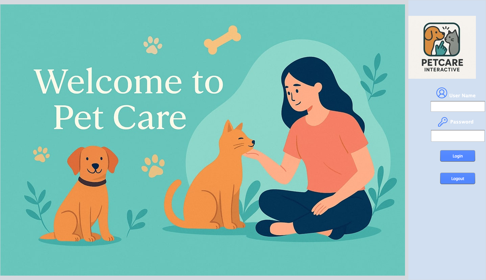
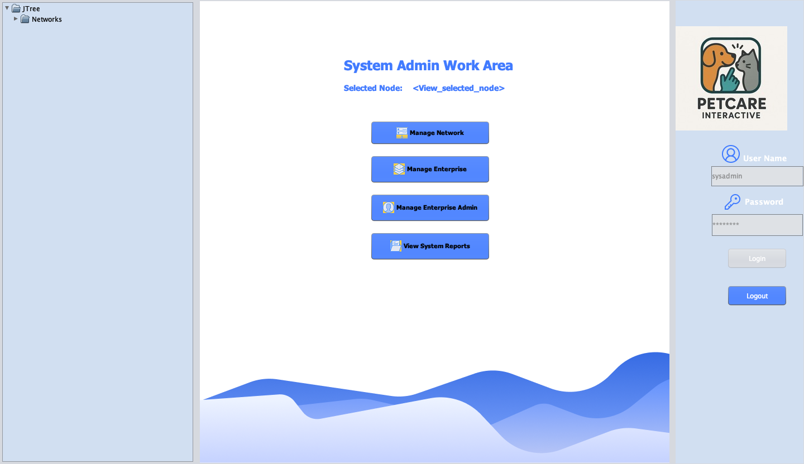
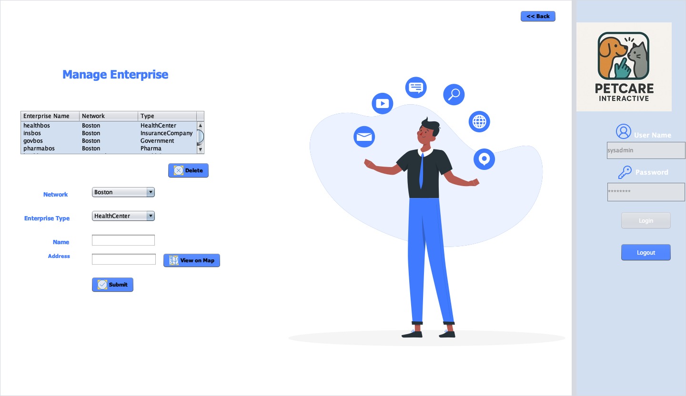
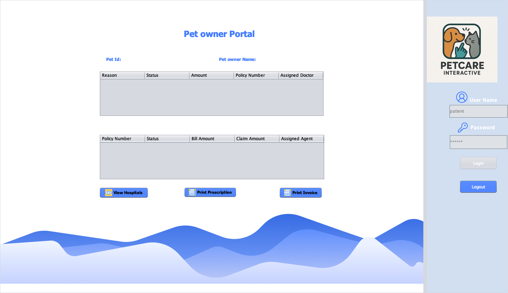

# Pet Care Interactive

A Java Swing desktop app that connects pet owners, care centers, pharmacies, insurers, and government funding bodies in one role-based ecosystem. Each user signs in to a work area for their role, and requests move between organizations through work queues: appointments, lab tests, prescriptions, billing, insurance claims, medicine orders, and fund requests. Data is stored in an embedded DB4O object database.



| System admin | Manage enterprises | Pet owner portal |
| --- | --- | --- |
|  |  |  |

## How it's organized

The model follows **EcoSystem → Network → Enterprise → Organization → UserAccount/Role**.

- **Networks** are regions identified by a ZIP code. The seeded networks are Boston (2120), New York (2121), and California (2122).
- Each network holds four **enterprise types**:

| Enterprise | Organizations (roles) |
| --- | --- |
| Health Center | Doctor, Lab Assistant, Accountant |
| Pharma | Manager, Transport |
| Insurance Company | Insurance Agent, Policy Planner, Finance |
| Government | Health Officer, Secretary, Treasurer |

On top of these, the **System Admin** manages networks, enterprises, and enterprise admins. Each **Enterprise Admin** manages their own organizations, employees, and user accounts. **Pet owners** get their own portal.

## Features by role

- **System Admin**
  - Create and delete networks and enterprises, and create enterprise admin accounts.
  - Browse the whole ecosystem as a tree.
  - View an "Overall Ecosystem Status" bar chart per network.
- **Enterprise Admin**
  - Manage organizations, employees, and user accounts.
  - Health Center admins can also order medicine and equipment from same-ZIP pharmacies, track those orders on a chart, and request funds from the government.
- **Accountant**
  - Register a pet owner (this also creates their login), take a webcam photo, look up their insurance policy, and book a visit with a doctor.
  - Process bills: collect payment in full or raise an insurance claim.
  - View an appointment-status chart.
- **Doctor**
  - Take a waiting visit and review the owner's record and photo.
  - Request a lab test and write a prescription.
  - Open the ICD diagnosis-code sheet (`ICD.xlsx`).
  - Complete treatment with an itemized bill (consultation, lab, medication, and miscellaneous charges).
- **Lab Assistant**: pick up lab requests and submit results.
- **Pet Owner**
  - See your visits and insurance claims.
  - Print your invoice and prescription.
  - Browse care centers with map, directions, and email-query buttons.
- **Insurance**
  - Planners define policies (coverage, monthly premium, terms).
  - Agents enroll customers and accept or reject claims.
  - Finance disburses or rejects approved claims.
- **Pharma**
  - Managers maintain the medicine menu, route orders to transport, and view order stats.
  - Transport delivers or rejects orders and gets directions to the center.
- **Government**: a fund request passes from Health Officer to Secretary to Treasurer. Any of them can reject it, and the Treasurer disburses it.

## Workflows

| Flow | Path |
| --- | --- |
| Visit | Accountant books → Doctor consults → Lab Assistant runs test → Doctor prescribes → Doctor bills |
| Billing and claims | Accountant collects payment, or files a claim → Insurance Agent → Insurance Finance |
| Medicine orders | Health Center admin → Pharma Manager (same ZIP) → Pharma Transport |
| Funding | Health Center admin → Health Officer → Secretary → Treasurer (same ZIP) |

Each step updates the request's status. Most steps also notify the people involved by email (JavaMail) and SMS (Twilio).

## Tech stack

| Area | Library |
| --- | --- |
| UI | Java Swing (NetBeans GUI builder), Nimbus look and feel |
| Persistence | DB4O 8.0 embedded object database (`Databank.db4o`) |
| Charts | JFreeChart 1.0.1 |
| Maps | Google Maps URLs in a JavaFX `WebView` (no API key needed) |
| Notifications | JavaMail over Gmail SMTP, Twilio SMS |
| Other | webcam-capture (owner photos), JCalendar (date picker) |
| Build | Apache Ant (NetBeans project), built with JDK 19 |

## Project structure

```
src/
├── petCare/                 # Model
│   ├── EcoSystem.java       # Root singleton
│   ├── ConfigureASystem.java# Seed data for a fresh database
│   ├── Network/ Enterprise/ Organization/ Role/ UserAccount/ Employee/
│   ├── WorkQueue/           # Work requests that move between organizations
│   ├── Patient/ Insurance/ InsuranceCustomer/ Order/ pet/
│   ├── DB4OUtil/            # Load/save Databank.db4o
│   └── Map/                 # MapViewer (JavaFX), SendEmail, SMS
└── userinterface/           # One package of Swing panels per role
    └── LandingPage.java     # Main class: login and work-area switching
```

## Running it

Run from the repo root. The app reads `Databank.db4o` and `ICD.xlsx` from the working directory.

```bash
java --add-opens java.base/java.util=ALL-UNNAMED \
     --add-opens java.base/java.lang=ALL-UNNAMED \
     --add-opens java.base/java.lang.reflect=ALL-UNNAMED \
     -jar dist/PetCare.jar
```

The `--add-opens` flags are needed on Java 9+ because DB4O uses reflection on JDK classes. Without them, login fails with an `InaccessibleObjectException`.

> **Note:** Changes are only saved to `Databank.db4o` when you click **Logout**. Closing the window throws away that session's changes.

### Sign-in accounts

| Role | Username | Password |
| --- | --- | --- |
| System Admin | `sysadmin` | `sysadmin` |
| Pet Owner | `patient` | `pet123` |
| Enterprise Admins | `healthbos`, `pharmabos`, `insbos`, `govbos` (Boston); `healthnew`, `pharmanew`, `insnew`, `govnew` (New York); `healthcal`, `pharmacal`, `inscal`, `govcal` (California) | `Money_1234` |

No doctor, lab, accountant, insurance, pharma, or government staff accounts are seeded. To try those roles, sign in as an enterprise admin and create an organization, an employee, and a user account.

### Optional integrations

- **SMS:** set `TWILIO_ACCOUNT_SID` and `TWILIO_AUTH_TOKEN`. The sender and recipient numbers are hard-coded in `src/petCare/Map/SMS.java` and the panels that call it.
- **Email:** put a Gmail address and app password in `src/petCare/Map/SendEmail.java`. Email actions fail until you do.
- **Maps:** the map, directions, and website buttons open a JavaFX `WebView`. The JavaFX jars in `dist/lib` don't include native libraries, so on a new machine run with a JavaFX SDK for your platform.
